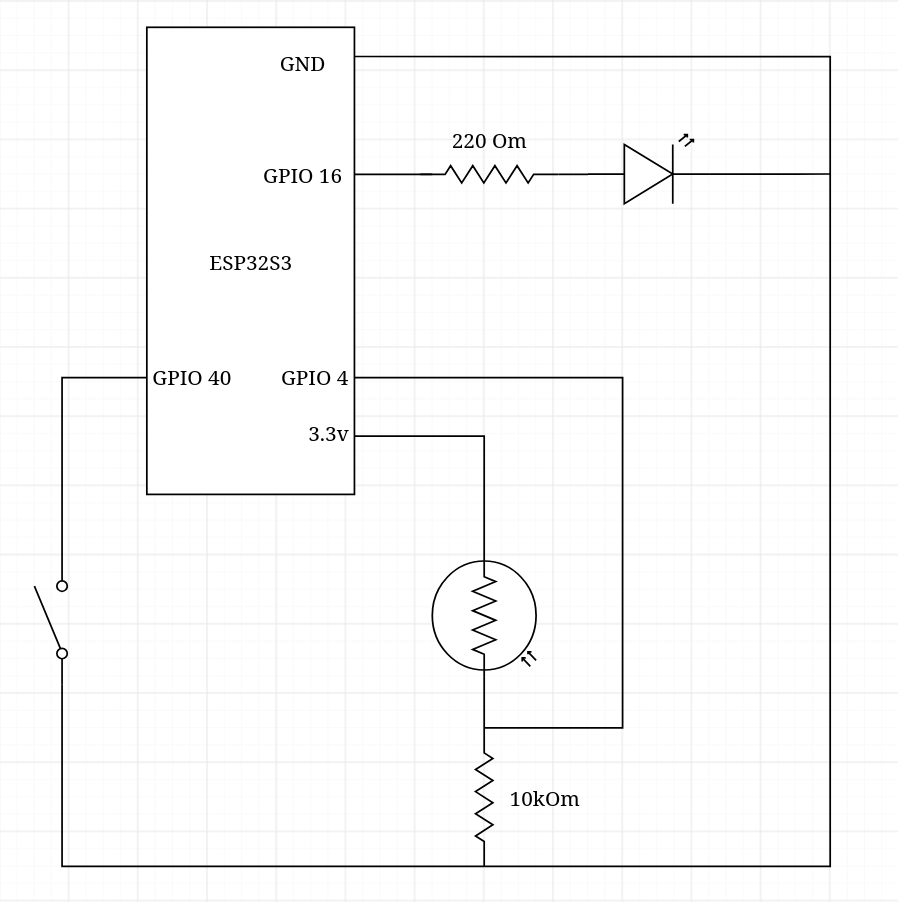
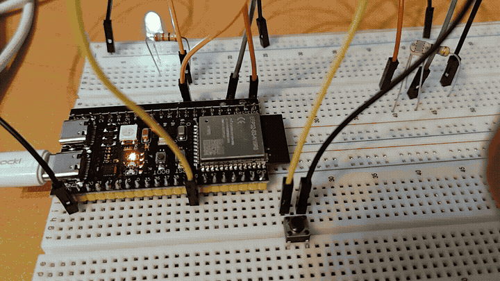

# Smart Light

Simple device that adjusts it's brightness based of environment lightning.

Structure:
- `light_sensor.h/.cpp` -- reads and samples value from LDR
- `led.h/.cpp` -- sets LED brightness via PWM, allows to request max brightness from outside
- `button.h/.cpp` -- reads and debounces button input

Scheme:

Demo:

