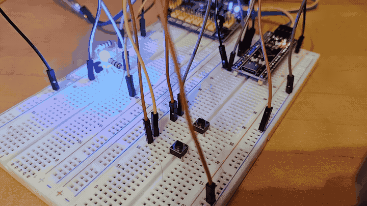

# Passive/active components

- 01_relay: controls relay via transistor and measures it's dry contact change duration via microsecond timer
- 02_pwm: simple software pwm for changing brightness of led using two buttons

02_pwm demo:

